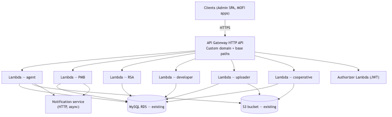
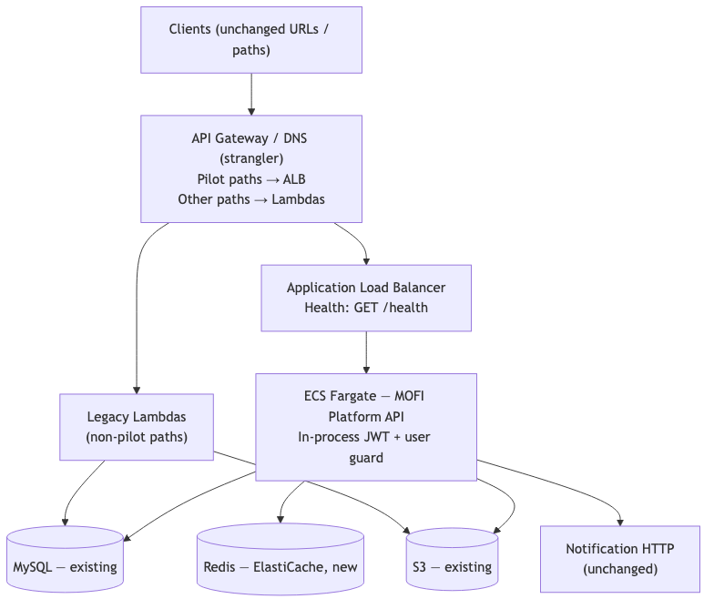

MOFI Platform API — ECS Migration (Pilot)

Infrastructure brief for engineering leadership

Audience: CTO / engineering leadership

Status: Pilot — implementation in progress

Date: October 2026

Author: Platform / MOFI engineering

# 1. EXECUTIVE SUMMARY

Pilot domain APIs move from separate NestJS Lambdas to one ECS Fargate service (MOFI Platform API), using a strangler cutover so URL paths stay the same for clients, including MofixQshelter Admin.

Unchanged in AWS: existing S3 bucket, existing MySQL, external notification service (HTTP via NOTIFICATION_URL). New: ECS Fargate, Application Load Balancer, ECR, Redis (ElastiCache sizing TBD).

The main cutover risk for clients is not path routing but **authorization**: the **API Gateway custom authorizer Lambda** remains the JWT gate; ECS Fargate runs behind Gateway (VPC Link → ALB) with no duplicate global JWT guard. Handler roles use the shared **@qshelter/nest-auth** library (Section 6).

# 2. CURRENT STATE (AS-IS)

Clients call one API host. API Gateway maps path prefixes to separate Lambda functions (agent, PMB, RSA, developer, uploader, cooperative, and others). Each pilot Lambda reads and writes the same existing MySQL and S3. A dedicated authorizer Lambda validates JWTs before traffic reaches domain Lambdas. The notification service is invoked asynchronously over HTTP and remains outside the domain Lambdas.

Figure 1: Current state architecture

Non-pilot routes (onboarding, apply, mortgage, propy, backoffice, wallet, and similar) stay on legacy Lambdas on the same host.

# 3. TARGET STATE (PILOT)

Pilot traffic stays on the **same API host**: API Gateway (custom authorizer) → VPC Link → Application Load Balancer → ECS Fargate (edge + domain containers). Non-pilot paths continue to existing Lambdas until later migration waves.

ECS tasks do **not** re-validate JWTs on the hot path in staging/production (`AUTH_ENFORCEMENT=gateway`). **@qshelter/nest-auth** supplies role checks and request helpers inside handlers. Tasks connect to existing MySQL and S3, add Redis (ElastiCache), and call the notification HTTP API unchanged.

Pilot AWS infrastructure (IaC): VPC, ECS cluster and service, ECR, load balancer, Secrets Manager for database and JWT credentials, logging, and IAM for S3 access from tasks.

Figure 2: Target state (pilot) architecture

# 4. PILOT SCOPE

Table 1: Pilot base paths

| Base path | Former Lambda | Notes |
| :---- | :---- | :---- |
| /agent | agent-api | Confirm Redis/ElastiCache before production |
| /pmb | pmb-api | |
| /rsa | rsa-api | Legacy approve/decline routes on RSA paths |
| /developer | Mofi-x-Qshelter-developers-func | |
| /uploader | Mofi-x-Qshelter-uploader-func | Existing S3 bucket |
| /cooperative | cooperative-api | |

Table 2: Unchanged dependencies

| Dependency | Role |
| :---- | :---- |
| Existing S3 bucket | Production uploads; ECS task IAM |
| Existing MySQL | Domain data; credentials in Secrets Manager |
| Notification HTTP API | NOTIFICATION_URL; stays external for pilot |
| Non-pilot Lambdas | Remain on API Gateway until later waves |

Deferred domains: bank-statement, publications, wallet, backoffice, mortgage, propy, onboarding, and others.

# 5. MIGRATION PHASES

| Phase | Activity | Rollback |
| :---- | :---- | :---- |
| 0 — Build | Monolith, infrastructure provisioning, automated API checks (including auth) | N/A |
| 1 — Staging ECS | Deploy load balancer; QA in staging | Production stays on Lambdas |
| 2 — Shadow | Compare staging ECS vs Lambdas on pilot paths; compare authorizer vs ECS auth outcomes | |
| 3 — Cutover | Route pilot base paths to load balancer | Revert gateway or DNS mapping |
| 4 — Soak | Retire pilot Lambdas | Keep container images for emergency |

# 6. AUTHORIZATION CARRYOVER

Today, API Gateway invokes a **custom authorizer Lambda** on protected routes. Clients (including MofixQshelter Admin) send `Authorization: Bearer <JWT>`; many routes also send a **`user_id` header** that must align with claims in the token. Domain Lambdas and middleware rely on those headers and claims after API Gateway has already allowed the request.

When pilot paths are routed **API Gateway (authorizer) → Application Load Balancer → ECS**, the authorizer step **remains in the path** for client traffic. ECS must **not** duplicate JWT validation on every domain container.

**Client contract (unchanged):**

Protected pilot routes continue to require a Bearer token. The `user_id` header remains part of the contract where it is used today. Public routes stay configured on the **authorizer Lambda** (cooperative login, selected “names” list endpoints, health, OPTIONS preflight).

**Inside ECS (Nest):**

Use **@qshelter/nest-auth** for handler-level authorization (`RolesGuard`, `@Roles`, `AuthHelper`, `RequestHelper`, Swagger decorators). Do not maintain a second global JWT gate in Fargate for production. Local `npm run start:dev` may use `AUTH_ENFORCEMENT=local` to approximate authorizer public routes when Gateway is not in the loop.

**Signature and secret parity:**

The authorizer Lambda validates tokens against production signing material. ECS role checks read claims from headers the client already sent; cutover is blocked until Phase 2 shadow tests match authorizer outcomes on Gateway-fronted ECS.

**Shadow and cutover checks:**

During Phase 2, run the same authenticated and unauthenticated calls against Lambda-backed staging and **Gateway-fronted** ECS staging on every pilot base path. Compare HTTP status codes and bodies for protected, public, and edge cases. Cutover proceeds only when outcomes match within agreed tolerance.

**Split-host behaviour during pilot:**

Non-pilot paths still use API Gateway plus the authorizer Lambda; pilot paths use Gateway → ALB → ECS. Tokens issued for the same environment must work on **both** sides until non-pilot domains migrate.

**Ops inputs for auth:**

Confirm authorizer public-route configuration matches platform expectations. Wire VPC Link from API Gateway to the MOFI ALB before production cutover. Confirm whether any pilot route depends on API Gateway authorizer context beyond headers.

# 7. DATA AND SECURITY

| Concern | Approach |
| :---- | :---- |
| Database | Existing MySQL; no schema change for this infrastructure pilot |
| Object storage | Existing S3 bucket in AWS |
| Authentication | Section 6 — API Gateway authorizer; @qshelter/nest-auth in Nest; no duplicate JWT guard on Fargate in prod |
| Secrets | Application secrets in Secrets Manager (staging and production) |
| Network | New VPC for ECS; connectivity to RDS via security groups (ops to align) |

# 8. RISKS

| Risk | Mitigation |
| :---- | :---- |
| Authorization regression | Section 6 shadow tests; same JWT secrets on ECS; public-route checklist |
| Path regression | Automated API checks; RSA legacy routes |
| MySQL connections | Connection pool tuning; monitoring |
| Redis timing | Agent domain review before ElastiCache in production |
| Partial cutover | Pilot paths only; gateway rollback; unified tokens across Lambda and ECS |

# 9. OPS INPUTS

1. RDS and network path from the ECS VPC to existing MySQL.
2. Redis requirement for the agent domain (ElastiCache vs defer).
3. Authorizer JWT secrets and validation rules for staging/production parity on ECS.
4. Staging cutover window and rollback owner.
5. Ordering of post-pilot migration waves after soak.

# 10. LEVELS 2–3 — MESSAGING AND DOMAIN RUNTIMES

After pilot cutover (phases 0–4), the platform evolves on the same Fargate deployment model:

Level 2 — Messaging foundation

- Amazon MQ for RabbitMQ in the ECS VPC (private, task security groups only).
- Domains publish notification and Lambda-invoke work to durable queues; worker containers call the existing notification HTTP API and Lambda functions unchanged.
- Feature flags: sync vs async notification delivery during migration (`NOTIFICATION_MODE`, `LAMBDA_INVOKE_MODE`).

Level 3 — Single Fargate service, one runtime per domain

- One task definition, one deploy pipeline, one ECR image.
- Containers: edge (ALB target, path routing), six pilot domain runtimes, optional worker for queue consumers.
- Inter-domain integration via RabbitMQ; external HTTP paths unchanged for clients.
- Rollback: redeploy prior image or switch CDK context `deploymentMode=monolith` for single-container mode.

Level 4 (optional)

- Split Fargate services per domain only if leadership accepts multiple deploy pipelines; messaging contracts stay stable.
