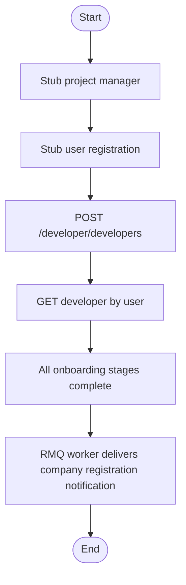

# Developer onboarding flow

## Goal

Validate that a newly registered user can complete **developer company onboarding** in the developer domain API:

1. A **user** record exists (stand-in for external onboarding/register).
2. A **project manager** user exists (audience for admin notification emails).
3. **POST /developer/developers** creates the developer with POCs, group entities, documents, directors, bank details, and terms acceptance.
4. All **onboarding stages** are marked completed on the persisted developer.
5. The developer can be retrieved **by user id**.
6. (In-process) **Company registration** notification is published to RabbitMQ, consumed by the platform worker, and delivered to the notification HTTP shim.

## Scope

| In scope | Out of scope |
|----------|----------------|
| Developer domain HTTP API (`/developer/*`) | Legacy onboarding Lambda |
| Single-shot create with full payload | Admin approval (`update-status`) |
| MySQL persistence | Real S3 uploads |
| RMQ + platform worker for notifications | Sync HTTP notification bypass |

## Stubs

| Dependency | Stub |
|------------|------|
| User registration (pre-developer) | `POST /developer/users` |
| Project managers | Second `POST /developer/users` with `project_manager` role |
| Notification HTTP API | Local HTTP shim (worker posts here after consuming `mofi.notifications.commands`) |
| Lambda notification ARN paths | `PlatformLambdaInvokeService` mock |
| Document upload | HTTPS URLs in JSON payloads |

## Execution modes

- **in-process** — Nest `DeveloperAppModule` + `WorkerAppModule` + test MySQL (`:3308`) + test RabbitMQ (`:5673`).
- **http** — `MOFI_PLATFORM_API_URL` pointing at edge (e.g. k8s `:8080`); notification milestone skipped unless you run the full stack with worker + Rabbit.

Enable with `SYSTEM_TESTS_ENABLED=true` or set `MOFI_PLATFORM_API_URL`.

## Milestone flow (expected)

Each run writes an updated chart to `REPORT.md` (pass/fail per node).

