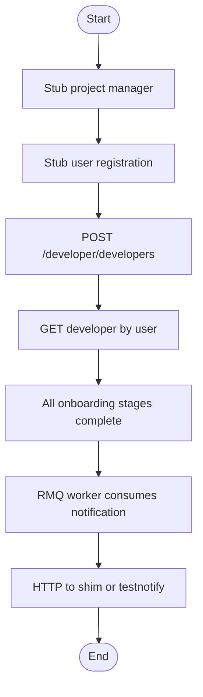

# Developer onboarding flow

## Goal

Validate that a newly registered user can complete **developer company onboarding** in the developer domain API:

1. A **user** record exists (stand-in for external onboarding/register).
2. A **project manager** user exists (audience for admin notification emails).
3. **POST /developer/developers** creates the developer with POCs, group entities, documents, directors, bank details, and terms acceptance.
4. All **onboarding stages** are marked completed on the persisted developer.
5. The developer can be retrieved **by user id**.
6. (In-process) **Company registration** notifications are published to RabbitMQ, consumed by the platform worker, and delivered over HTTP (local shim or real testnotify).

## Scope

| In scope | Out of scope |
|----------|----------------|
| Developer domain HTTP API (`/developer/*`) | Legacy onboarding Lambda |
| Single-shot create with full payload | Admin approval (`update-status`) |
| MySQL persistence | Real S3 uploads |
| RMQ + platform worker for notifications | Automated Gmail inbox proof in real mode |

## Stubs / fixtures

| Dependency | Default in-process | Real testnotify (`SYSTEM_TEST_NOTIFICATION_TARGET=real`) |
|------------|-------------------|----------------------------------------------------------|
| User registration | `POST /developer/users` (faker email) | Same; developer email defaults to **`efagenevalentine@gmail.com`** |
| Project managers | `POST /developer/users` (`project_manager`) | PM email defaults to **`efagenevalentine@gmail.com`** (`to_email` on admin template) |
| Notification HTTP | Local shim | Qshelter testnotify (`NOTIFICATION_URL`) |
| Lambda ARN paths | `PlatformLambdaInvokeService` mock | unchanged |
| Document upload | HTTPS URLs in JSON | unchanged |

## Execution modes

- **in-process (shim)** — `DeveloperAppModule` + `WorkerAppModule` + MySQL `:3308` + Rabbit `:5673`; HTTP captured on local shim.
- **in-process (real)** — same stack; requires `SYSTEM_TEST_ALLOW_REAL_NOTIFICATIONS=true`; asserts **RMQ ack** on `mofi.notifications.commands`; manual inbox check noted in `REPORT.md`.
- **http** — `MOFI_PLATFORM_API_URL` pointing at edge; notification milestones skipped unless full platform worker + Rabbit are running.

Enable with `SYSTEM_TESTS_ENABLED=true` or set `MOFI_PLATFORM_API_URL`.

## Milestone flow (expected)

Each run writes an updated chart to `REPORT.md` (pass/fail per node).

