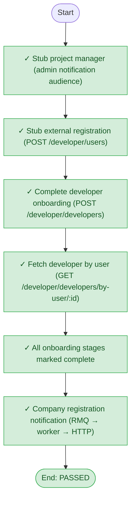

# Test report

| Field | Value |
|-------|-------|
| Scenario | developer-onboarding-flow |
| Mode | in-process |
| **Overall** | **PASSED** |
| Failed at | — |
| Milestones passed | 6 / 6 |
| Started | 2026-11-09T13:07:23.689Z |
| Finished | 2026-11-09T13:07:25.476Z |

## Milestone flow

Where the run stopped (if it failed) is shown on the chart.



## Milestone checklist

| # | Milestone | Status | Detail |
|---|-----------|--------|--------|
| 1 | Stub project manager (admin notification audience) | ✅ passed | pm+fadnbf@system-tests.mofi |
| 2 | Stub external registration (POST /developer/users) | ✅ passed | userId=28, email=developer-onboarding+wdg0igfk@system-tests.mofi |
| 3 | Complete developer onboarding (POST /developer/developers) | ✅ passed | developerId=14 |
| 4 | Fetch developer by user (GET /developer/developers/by-user/:id) | ✅ passed |  |
| 5 | All onboarding stages marked complete | ✅ passed | BUSINESS_DETAILS, GROUP_ENTITIES, DEVELOPER_DOCUMENTS, BANK_INFORMATION, DIRECTORS_FORM, TERMS_AND_CONDITION |
| 6 | Company registration notification (RMQ → worker → HTTP) | ✅ passed | /admin/developer-company-registration |

## ASCII flow

```
START
 │ ✓ Stub project manager (admin notification audience)
 │ ✓ Stub external registration (POST /developer/users)
 │ ✓ Complete developer onboarding (POST /developer/developers)
 │ ✓ Fetch developer by user (GET /developer/developers/by-user/:id)
 │ ✓ All onboarding stages marked complete
 │ ✓ Company registration notification (RMQ → worker → HTTP)
 └── END (PASSED)
```

## Step log

- **Stub project manager (admin notification audience)** — passed: pm+fadnbf@system-tests.mofi
- **Stub external registration (POST /developer/users)** — passed: userId=28, email=developer-onboarding+wdg0igfk@system-tests.mofi
- **Complete developer onboarding (POST /developer/developers)** — passed: developerId=14
- **Fetch developer by user (GET /developer/developers/by-user/:id)** — passed
- **All onboarding stages marked complete** — passed: BUSINESS_DETAILS, GROUP_ENTITIES, DEVELOPER_DOCUMENTS, BANK_INFORMATION, DIRECTORS_FORM, TERMS_AND_CONDITION
- **Company registration notification (RMQ → worker → HTTP)** — passed: /admin/developer-company-registration

## Notes

- developerId=14, userId=28, pm=pm+fadnbf@system-tests.mofi, notificationTarget=shim

_This file is overwritten on each test run. Every scenario report includes a milestone flow chart._
