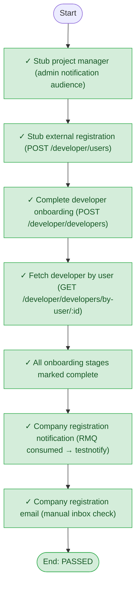

# Test report

| Field | Value |
|-------|-------|
| Scenario | developer-onboarding-flow |
| Mode | in-process |
| **Overall** | **PASSED** |
| Failed at | — |
| Milestones passed | 7 / 7 |
| Started | 2026-11-09T21:50:01.411Z |
| Finished | 2026-11-09T21:50:32.319Z |

## Milestone flow

Where the run stopped (if it failed) is shown on the chart.



## Milestone checklist

| # | Milestone | Status | Detail |
|---|-----------|--------|--------|
| 1 | Stub project manager (admin notification audience) | ✅ passed | efagenevalentine@gmail.com |
| 2 | Stub external registration (POST /developer/users) | ✅ passed | userId=48, email=efagenevalentine@gmail.com |
| 3 | Complete developer onboarding (POST /developer/developers) | ✅ passed | developerId=24 |
| 4 | Fetch developer by user (GET /developer/developers/by-user/:id) | ✅ passed |  |
| 5 | All onboarding stages marked complete | ✅ passed | BUSINESS_DETAILS, GROUP_ENTITIES, DEVELOPER_DOCUMENTS, BANK_INFORMATION, DIRECTORS_FORM, TERMS_AND_CONDITION |
| 6 | Company registration notification (RMQ consumed → testnotify) | ✅ passed | mofi.notifications.commands deliverDelta=1, ready=0, unacked=0 |
| 7 | Company registration email (manual inbox check) | ✅ passed | Manual: check inbox efagenevalentine@gmail.com for company registration template. |

## ASCII flow

```
START
 │ ✓ Stub project manager (admin notification audience)
 │ ✓ Stub external registration (POST /developer/users)
 │ ✓ Complete developer onboarding (POST /developer/developers)
 │ ✓ Fetch developer by user (GET /developer/developers/by-user/:id)
 │ ✓ All onboarding stages marked complete
 │ ✓ Company registration notification (RMQ consumed → testnotify)
 │ ✓ Company registration email (manual inbox check)
 └── END (PASSED)
```

## Step log

- **Stub project manager (admin notification audience)** — passed: efagenevalentine@gmail.com
- **Stub external registration (POST /developer/users)** — passed: userId=48, email=efagenevalentine@gmail.com
- **Complete developer onboarding (POST /developer/developers)** — passed: developerId=24
- **Fetch developer by user (GET /developer/developers/by-user/:id)** — passed
- **All onboarding stages marked complete** — passed: BUSINESS_DETAILS, GROUP_ENTITIES, DEVELOPER_DOCUMENTS, BANK_INFORMATION, DIRECTORS_FORM, TERMS_AND_CONDITION
- **Company registration notification (RMQ consumed → testnotify)** — passed: mofi.notifications.commands deliverDelta=1, ready=0, unacked=0
- **Company registration email (manual inbox check)** — passed: Manual: check inbox efagenevalentine@gmail.com for company registration template.

## Notes

- developerId=24, userId=48, pm=efagenevalentine@gmail.com, notificationUrl=https://api.qshelter.ng/testnotify/email
- Manual: check inbox efagenevalentine@gmail.com for company registration template.

_This file is overwritten on each test run. Every scenario report includes a milestone flow chart._
